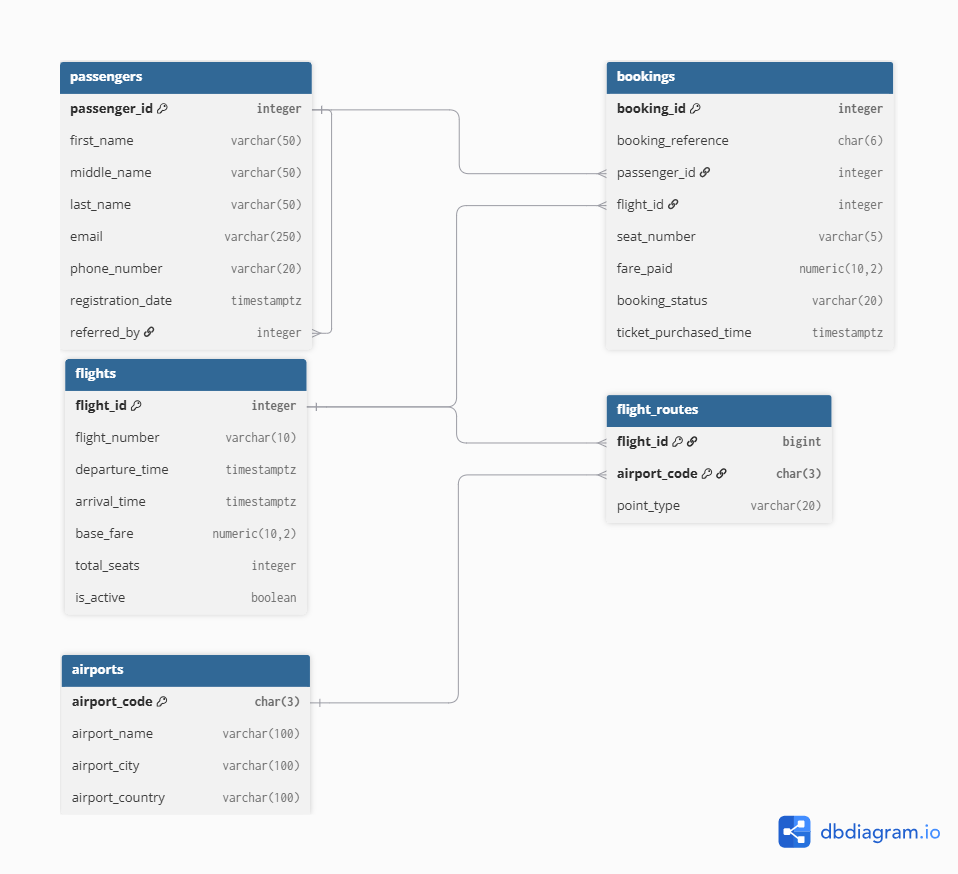

EX603 Data and Algorithms for Scalable Systems  
Name: Shin Eui Lee  

# Project Title: Airline Booking and Operation Sytem
A relational database managing airline operation including managing flights, passenger reservations and routes. 

## Theme: Airline Booking

  - actor: passangers
  - producer: flights
  - event: bookings
  - catalog: airports
  - junction: flight_routes
  - metric: fare_paid

What the system does: A relational database for a large-scale application for airline booking

## Domain Overview

This platform is an airline booking system where passengers can sign up, search for flights, book seats, and manage their reservations. Behind the scenes, it helps the airline organize its daily operations by scheduling flight times, connecting flights to departure and arrival airports, and preventing planes from being overbooked. The system keeps all of this information in one place so the company always knows who is flying and how much they paid.

To support everyday operations, the database answers several key questions. For flight tracking, it shows which flights are arriving at or departing from a specific airport and their scheduled times. For customer and revenue management, it helps staff quickly see who is booked on each flight, how many open seats remain, and how much money each flight has generated from ticket sales.

## Entity Relationship Diagram (ERD)

### ERD Image

### ERD diagram source

// Actor: passengers
Table passengers {
  passenger_id bigint [primary key]
  first_name varchar(50)
  middle_name varchar(50)
  last_name varchar(50)
  email varchar(250)
  phone_number varchar(20)
  registration_date timestamptz
}

// Producer: flights
Table flights {
  flight_id bigint [primary key]
  flight_number varchar(10)
  departure_time timestamptz
  arrival_time timestamptz
  base_fare numeric(10,2)
  total_seats integer
  is_active boolean
}

// Event: bookings
Table bookings {
  booking_id bigint [primary key]
  booking_reference char(6)
  passenger_id bigint
  flight_id bigint
  seat_number varchar(5)
  fare_paid numeric(10,2)
  booking_status varchar(20)
  ticket_purchased_time timestamptz
}

// Catalog: airports
Table airports {
  airport_code char(3) [primary key]
  airport_name varchar(100)
  airport_city varchar(100)
  airport_country varchar(100)
}

// Junction: flight_routes
Table flight_routes {
  flight_id bigint
  airport_code char(3)
  point_type varchar(20)

  indexes {
    (flight_id, airport_code) [pk]
  }
}

// Relationships 
Ref: passengers.passenger_id < bookings.passenger_id
Ref: flights.flight_id < bookings.flight_id
Ref: flights.flight_id < flight_routes.flight_id
Ref: airports.airport_code < flight_routes.airport_code

### Updated ERD diagram source (Assignment 2)

// Actor: passengers
Table passengers {
  passenger_id integer [pk, increment]
  first_name varchar(50)
  middle_name varchar(50)
  last_name varchar(50)
  email varchar(250)
  phone_number varchar(20)
  registration_date timestamptz
  referred_by integer
}

// Producer: flights
Table flights {
  flight_id integer [pk, increment]
  flight_number varchar(10)
  departure_time timestamptz
  arrival_time timestamptz
  base_fare numeric(10,2)
  total_seats integer
  is_active boolean
}

// Event: bookings
Table bookings {
  booking_id integer [pk, increment]
  booking_reference char(6)
  passenger_id integer
  flight_id integer
  seat_number varchar(5)
  fare_paid numeric(10,2)
  booking_status varchar(20)
  ticket_purchased_time timestamptz
}

// Catalog: airports
Table airports {
  airport_code char(3) [pk]
  airport_name varchar(100)
  airport_city varchar(100)
  airport_country varchar(100)
}

// Junction: flight_routes
Table flight_routes {
  flight_id bigint
  airport_code char(3)
  point_type varchar(20)

  indexes {
    (flight_id, airport_code) [pk]
  }
}

// Relationships 
Ref: passengers.passenger_id < bookings.passenger_id
Ref: flights.flight_id < bookings.flight_id
Ref: flights.flight_id < flight_routes.flight_id
Ref: airports.airport_code < flight_routes.airport_code
Ref: passengers.referred_by > passengers.passenger_id

## Schema Design

The relational database schema for flight operations and reservations built for PostgreSQL 14+.

* **passengers (actor)**: Stores customer accounts. Uses an auto-generated identity integer key and an enforced UNIQUE constraint on emails, with members referral tracking.
* **airports (catalog)**: Stores airport information, using the global 3-letter airport codes (CHAR(3)) as the primary key.
* **flights (producer)**: Stores flight schedules, seat capacity, ticket prices with basic schedule and fare validation.
* **flight_routes (junction)**: Resolves many-to-many associations between flights and airports. Utilizes a composite primary key (flight_id, airport_code) to prevent duplicate entries.
* **bookings (event)**: Stores flight reservations and paid fares, keeping a record of passenger ticket history and standard reservation statuses like confirmed or canceled. 

### Key Design Decisions
* **Protecting Booking History:** Foreign keys on bookings utilize ON DELETE RESTRICT to ensure passenger reservations and payment records are not accidentally deleted, ensuring booking records stay intact.
* **Automated Cleanup for Schedules:** Deleting a flight automatically removes its associated route stops in flight_routes using ON DELETE CASCADE.
* **Data Validation Checks:** CHECK constraints on status values, seat capacity, departures/arrival times so invalid data cannot enter the database.

## Unit 4: Booking Fare and No-Show Analysis

Used the same airline booking data from Unit 3. The metric is fare_paid, the actor is passenger_id, and the producer is flight_id. booking_country was used as a region label. For this report, failure means a booking with cancellation_reason = 'Passenger no show'.

- queries/unit4/q4_1.sql: Overall booking and fare summary, actual no-show rate, counts by flight, HAVING, and flight plus country results.
- queries/unit4/q4_2.sql: Total bookings and no-shows in one query, country subtotals and platform grand total, and a CTE baseline for busy flights.
- analysis/unit4.md: Explanations for Tasks 4.1 and 4.2 and the reflection.
- analysis/unit4-finding.md: Main finding and which flight IDs recommended for reviewing.
- screenshots/unit4: Full screenshots from pgAdmin showing all query and its result together.

## Unit 6: Window Functions and Analytics

Used the same airline booking data from previous units to analyze individual booking fares, flight popularity, booking patterns, and passenger no-show trends using SQL window functions. The metric is `fare_paid`, the actor is `passenger_id`, and the producer is `flight_id`. As defined in Unit 4, failure means a booking with `cancellation_reason = 'Passenger no show'`.

### SQL Queries and Analysis

- [queries/unit6/q6_1.sql](queries/unit6/q6_1.sql): Comparison of individual booking fares with flight averages, comparison of window functions and GROUP BY, flight popularity rankings using ROW_NUMBER, RANK, and DENSE_RANK, and flight grouping using NTILE.
- [queries/unit6/q6_2.sql](queries/unit6/q6_2.sql): Comparison of consecutive booking fares using LAG and LEAD, running fare totals, moving averages, revenue target progress, and detection of booking gaps.
- [queries/unit6/q6_3.sql](queries/unit6/q6_3.sql): Top three booking fares per flight, month-over-month booking and fare comparisons, monthly and quarterly passenger no-show rates, and data coverage analysis.
- [analysis/unit6.md](analysis/unit6.md): Explanations, query results, business interpretations, and write-ups for Tasks 6.1, 6.2, and 6.3, including the supporting analyses and reflection.
- [analysis/unit6-finding.md](analysis/unit6-finding.md): Closing memo for Task 6.4, including passenger no-show trends, data limitations, supporting evidence, and recommendations for the next quarter.
- [screenshots/unit6](screenshots/unit6): Screenshots from pgAdmin showing the executed SQL queries and their results.

### Key Findings

- Window functions preserved all 200 individual booking records, while GROUP BY returned only 13 flight-level summary rows.
- A total of 12 passenger no-shows were identified across 200 bookings, resulting in an overall recorded no-show rate of 6.00%.
- The quarterly passenger no-show rate decreased from 7.55% in Q1 to 4.17% in Q4, suggesting improvement at the quarterly level.
- Monthly no-show rates remained inconsistent, including an increase to 12.50% in December after two months without recorded no-shows.
- The limited sample size and historical coverage prevent a definitive conclusion about sustained improvement.

### Recommendations for the Next Quarter

- Monitor monthly and quarterly passenger no-show rates.
- Investigate recurring passenger no-show cases and test preventive measures.
- Expand historical data coverage and improve the collection of flight departure and no-show occurrence timestamps.

Additional findings, supporting SQL queries, and detailed recommendations are available in the [Unit 6 Closing Memo](analysis/unit6-finding.md).
